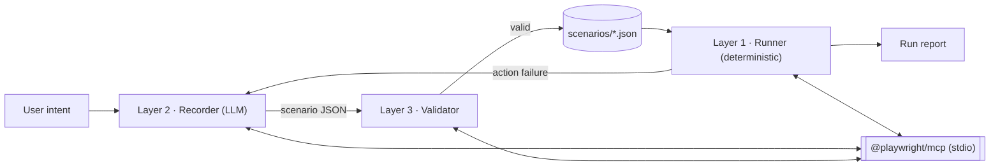

# Argos Agent — Overview

Argos Agent runs pixel-code test scenarios against live websites and reports whether the expected tracking
requests were sent. It is not a pure agent: runs are deterministic, and an LLM steps in only to author a
scenario or to repair one that no longer runs (for example, after a CSS selector changed).

## Goals

- **Deterministic runs.** A scenario JSON is executed the same way every time, with no LLM in the loop.
- **A report per run.** Every run ends in a machine-readable report: what ran, what was sent, which success
  criteria passed or failed.
- **Self-maintenance.** When a scenario can no longer be executed, an LLM updates the scenario JSON, the JSON is
  validated again, and the run is retried.

## Principles

1. **Exact MCP, nothing invented.** Every action in a scenario is a Playwright MCP tool call: the same tool name,
   the same argument names, the same argument types. The allowed tools and arguments come from the pinned
   server's own `tools/list` response, never from a hand-written list.
2. **Real user behavior only.** Scenarios do what a user would do on the page. No reloads, extra navigations or
   page rewrites to make a run pass. If the MCP server cannot do something, the run fails honestly.
3. **The MCP server is a black box.** Problems are diagnosed from tool inputs and outputs only.
4. **Pinned server.** One `@playwright/mcp` version is pinned. Scenarios are validated against that version's
   tool catalog, and the runner parses that version's text output.
5. **Criteria are never auto-healed.** A pixel that did not fire is a finding, not a maintenance task.

## Architecture



All three layers talk to the same Playwright MCP server over stdio. Layer 1 is a Python MCP client.

### Layer 1 — Runner (deterministic)

1. Load the scenario JSON and check it statically (see Layer 3). An invalid scenario fails before the browser starts.
2. Start the pinned server, adding any device flags given for the run (see [Device emulation](#device-emulation)).
3. Run each step's actions in order as `tools/call` requests, with a short random pause between actions.
4. Collect network requests from every open tab with `browser_network_requests` (`static: true`, `all: true`),
   switching tabs with `browser_tabs`, and read POST bodies with `browser_network_request`
   (`part: "request-body"`).
5. Evaluate each step's success criteria against the requests captured while that step ran.
6. Write the run report and exit with `0` on success, `1` otherwise.

### Layer 2 — Recorder (LLM)

- **Authoring:** given a user intent (for example "search for a rental flat in Istanbul and open the first
  listing"), the LLM drives the site through the same MCP tools, then writes a scenario JSON with the actions
  it took and success criteria for the pixel requests the intent should send.
- The LLM acts on snapshot refs (`e12`) while exploring. Refs change on every run, so before writing the JSON
  each ref is turned into a stable locator with `browser_generate_locator`, for example
  `getByRole('button', { name: 'Telefonu Göster' })`, which `target` accepts as-is.
- **Repair:** given a scenario and a failed run report, the LLM revisits the page and rewrites only the failing
  `actions`.

### Layer 3 — Validator

- **Static check:** the JSON matches the scenario format; every `action` names a tool in the pinned catalog;
  every `params` object validates against that tool's `inputSchema` with no extra properties; no snapshot
  refs are used as targets; every provider is known.
- **Run check:** the scenario is run once by Layer 1 and must pass.
- **Repair guard:** a repaired scenario must keep its `success_criteria` unchanged; any criteria change needs a
  human's approval.

## Self-maintenance loop

```
Layer 1 run ──success──▶ report
     │
     ├─ criteria failure ─▶ report as a finding (no repair)
     │
     └─ action failure (element not found, strict-mode violation, timeout)
            ▶ Layer 2 repairs actions ▶ Layer 3 validates ▶ Layer 1 runs again ▶ report
```

The report names the original failure and the repair, so a human can see what changed.

## Scenario format

A scenario file is a JSON array of steps, run in order. Full example:
[scenario-example.json](scenario-example.json) (emlakjet: home page → "En Yeni" tab → first listing → phone).

```json
[
  {
    "scenario": [
      { "action": "browser_navigate", "params": { "url": "https://www.emlakjet.com/" } }
    ],
    "success_criteria": [
      {
        "provider": { "name": "gtm", "params": [] },
        "conditions": [{ "key": "id", "match": "exact", "value": "GTM-MRDH2NZ" }]
      }
    ]
  },
  {
    "scenario": [
      { "action": "browser_mouse_wheel", "params": { "deltaX": 0, "deltaY": 300 } },
      { "action": "browser_click", "params": { "target": "text=\"En Yeni\"" } }
    ],
    "success_criteria": [
      {
        "provider": { "name": "ga4", "params": [] },
        "conditions": [
          { "key": "en", "match": "exact", "value": "view_item_list" },
          { "key": "pr1.id", "match": "regex", "value": "^\\d+$" }
        ]
      }
    ]
  }
]
```

- **`scenario[]`**: the step's actions, run in order. `action` is the Playwright MCP tool name and `params` its
  arguments, sent unchanged as the `name` and `arguments` of a `tools/call` request. The runner adds, renames or
  rewrites nothing.
- **`success_criteria[]`** (optional): judged against the requests sent while the step's actions ran. A
  criterion identifies pixel requests through a preset provider (`ga4`, `gtm`) or through `custom` with a single
  `url` rule, then `conditions` check the request's parameters. Match types: `exact`, `contains`, `startsWith`,
  `endsWith`, `regex`, `exists`. Query parameters and each POST body line form one event. Compound parameters
  are expanded into dot notation (`pr1.nm`), and `ep.*` keys work as-is.

### Element targets

Every element param (`target`, `startTarget`, `endTarget`, `fields[].target`) is a single string. What the
pinned server accepts, checked by a black-box probe on a local page:

| Value | Accepted | Behavior |
|---|---|---|
| CSS, `:has()`, selector lists | yes | `aside[aria-label="İlan Sahibi"] button:has(.ee-icon-phone)` |
| `text="En Yeni"` | yes | exact text match |
| `text=En Yeni` | yes | case-insensitive substring; also matches "En Yeni İlanlar" |
| `… >> visible=true >> nth=0` | yes | first element a user can see; `>> nth=0` alone can pick a hidden copy and time out |
| `getByRole('button', { name: 'Telefonu Göster' })` | yes | the form `browser_generate_locator` returns |
| snapshot ref (`e12`) | yes, but not allowed | refs change on every run |
| `{"selector": …}` object or a list of candidates | no | not a string; rejected by the tool schema |

- A target must match exactly one element. Playwright runs in strict mode, so two matches fail the action.
- Use `>> visible=true >> nth=0` only when the step means "the first of a list" (the first listing, `pr1.lp = 1`).
- No fallback candidates. When a target stops matching, the self-maintenance loop replaces it.

### Device emulation

Device emulation is not part of the scenario file. Playwright MCP emulates devices through launch flags, not
tools, so a mobile run passes `--device` (or `--viewport-size` and `--user-agent`) to the runner, which hands it to
the server unchanged.

## Run report

A JSON object with:

- `status`: `success` (every action ran and every criterion passed), `fail` (an action or a criterion failed),
  or `error` (the scenario is invalid or the server could not be reached).
- For an action failure: the step and action number, the tool call as sent, the server's error, and the open
  pages.
- For each criterion: `pass`/`fail`, the matching request URL, or the closest request and which conditions it
  missed.
- Warnings, for example a POST body that could not be read.

## MCP server

- Package: `@playwright/mcp@0.0.84`, started with `npx` over stdio.
- Fixed flags: `--isolated` (in-memory profile, discarded after the run), `--caps=network,storage,testing,vision,pdf,devtools,config`
  (every documented tool is callable), `--codegen none`, `--output-max-size`.
- The tool catalog (`tool_schemas.json`) is generated from the server's `tools/list` response and regenerated
  whenever the pinned version changes.

| Capability | Tools |
|---|---|
| core (always on) | `browser_navigate`, `browser_navigate_back`, `browser_snapshot`, `browser_find`, `browser_click`, `browser_hover`, `browser_drag`, `browser_drop`, `browser_type`, `browser_fill_form`, `browser_select_option`, `browser_press_key`, `browser_take_screenshot`, `browser_tabs`, `browser_handle_dialog`, `browser_file_upload`, `browser_console_messages`, `browser_network_requests`, `browser_network_request`, `browser_evaluate`, `browser_run_code_unsafe`, `browser_wait_for`, `browser_close`, `browser_resize` |
| `network` | `browser_route`, `browser_route_list`, `browser_unroute`, `browser_network_state_set` |
| `storage` | `browser_cookie_{list,get,set,delete,clear}`, `browser_localstorage_{list,get,set,delete,clear}`, `browser_sessionstorage_{list,get,set,delete,clear}`, `browser_storage_state`, `browser_set_storage_state` |
| `testing` | `browser_generate_locator`, `browser_verify_element_visible`, `browser_verify_text_visible`, `browser_verify_list_visible`, `browser_verify_value` |
| `devtools` | `browser_start_tracing`, `browser_stop_tracing`, `browser_start_video`, `browser_stop_video`, `browser_video_chapter`, `browser_video_show_actions`, `browser_video_hide_actions`, `browser_start_recording`, `browser_stop_recording`, `browser_highlight`, `browser_hide_highlight`, `browser_annotate`, `browser_resume` |
| `pdf` | `browser_pdf_save` |
| `vision` | `browser_mouse_move_xy`, `browser_mouse_click_xy`, `browser_mouse_drag_xy`, `browser_mouse_down`, `browser_mouse_up`, `browser_mouse_wheel` |
| `config` | `browser_get_config` |

Source: [playwright.dev/mcp/introduction](https://playwright.dev/mcp/introduction). The 0.0.84 server also
exposes `browser_emulate_media`, which the introduction page does not list. The generated catalog, not this
table, is the source of truth.

## Out of scope

- Whether the vendor received the hit, and the client's analytics data quality.
- Staging environments, self-signed certificates, region or proxy testing. Scenarios target live production
  sites and run unattended on a schedule.
- Changes to, or diagnosis inside, the MCP server.

## Roadmap

| Phase | Deliverable |
|---|---|
| 0 | This document |
| 1 | Layer 1 Runner: MCP client, tool catalog, scenario check, network capture, criteria, report |
| 2 | Layer 3 Validator: static check CLI, run check, repair guard |
| 3 | Layer 2 Recorder: authoring from intent, repair from a failed report, self-maintenance loop |
